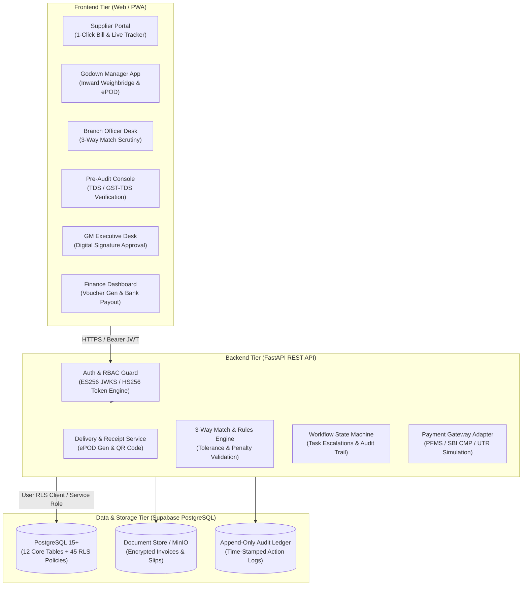

# Automated State Commodity Supplier Billing and Payment Processing

[](https://fastapi.tiangolo.com/)
[](https://supabase.com/)
[](https://python.org)
[](backend/tests/)

> **Seva First Innovation Challenge (SFIC 2026)**  
> **Problem Statement Code**: `PS000007`  
> **Nodal Agency**: Gujarat State Civil Supplies Corporation Limited (GSCSCL)  
> **Department**: Food, Civil Supplies & Consumer Affairs Department, Government of Gujarat  
> **Nodal Contact**: `mgrfin-gscscl@gujarat.gov.in`

---

## 1. Executive Summary & Ground Problem

GSCSCL procures and distributes millions of metric tonnes of essential foodgrains, pulses, and commodities across 250+ godowns in Gujarat. The legacy procurement-to-payment cycle suffers from severe structural bottlenecks:

```
[Current Broken Workflow: 30–60 Days Turnaround]
Truck at Godown ➔ Handwritten "Yellow Receipt" (પીળી પાવતી) ➔ Physical Paper Couriered to Gandhinagar HQ
  ➔ Manual Folder (Dossier) Prepared ➔ Manual Calculator Math ➔ Desk-to-Desk Physical File Movement
  ➔ Fragmented Email/e-Sarkar Communication ➔ Lost Papers / Delayed Payout / Capital Blockage
```

### The 5 Core System Mandates:
1. **Disintermediate the "Yellow Receipt"**: Replace vulnerable paper receipts with cryptographically signed, digitally authenticated electronic Proof of Delivery (**ePOD**) issued at godowns.
2. **1-Click Supplier Billing**: Allow suppliers to submit digital tax invoices linked directly to verified ePODs, auto-populating contract PO rates to eliminate arithmetic errors.
3. **Automated 3-Way Reconciliation**: Algorithmically cross-verify:
   $$\text{Purchase Order (Contract Terms)} \iff \text{Godown Inward (Weighbridge Gross/Tare/Moisture)} \iff \text{Supplier Invoice}$$
4. **Multi-Tier Digital Approval Pipeline**: Role-based electronic file movement:
   $$\text{Branch Scrutiny (CGP/TOC)} \longrightarrow \text{Pre-Audit (Statutory TDS/GST)} \longrightarrow \text{General Manager (e-Sign/DSC)} \longrightarrow \text{Finance (Disbursement)}$$
5. **Direct Banking & e-Sarkar Integration**: Interface with Gujarat's e-Sarkar file registry and simulate automated disbursement via PFMS / SBI CMP with live UTR status tracking.

---

## 2. System Architecture

The solution uses a decoupled, secure cloud-native architecture enforcing strict tenant isolation and Row-Level Security (RLS):



---

## 3. Technology Stack

| Layer | Technology | Purpose & Rationale |
| :--- | :--- | :--- |
| **Frontend** | HTML5, CSS3, JavaScript (ES6+), Fetch API | Lightweight, zero-framework overhead, compatible with remote low-bandwidth godown terminals. |
| **Backend API** | Python 3.11+, [FastAPI](https://fastapi.tiangolo.com/) | High-performance asynchronous REST API with auto-generated OpenAPI / Swagger docs. |
| **ASGI Server** | [Uvicorn](https://www.uvicorn.org/) | Lightning-fast ASGI production server. |
| **Database** | [Supabase](https://supabase.com/) (PostgreSQL 15+) | ACID-compliant relational DB with 45 granular Row-Level Security (RLS) policies. |
| **Authentication** | Supabase Auth + PyJWT (`ES256` / `HS256`) | Cryptographic JWT verification via JWKS public keys; RBAC role checks on every endpoint. |
| **Validation** | [Pydantic V2](https://docs.pydantic.dev/) | Strict request/response payload typing and schema enforcement. |
| **Testing** | [pytest](https://docs.pytest.org/), `pytest-asyncio`, `httpx` | Asynchronous API testing, RBAC security verification, and edge-case validation. |
| **Payment Simulator** | Mock PFMS / SBI CMP Banking Service | Simulates payment vouchers, bank processing latency, and UTR generation for prototypes. |

---

## 4. Role-Based Access Control (RBAC) Matrix

The system maps explicitly to the official GSCSCL organizational hierarchy:

| Role Identifier | Portal / Persona | Access & Responsibilities |
| :--- | :--- | :--- |
| `ADMIN` | System Administrator | System-wide configuration, master data maintenance, audit ledger review. |
| `SUPPLIER` | State Commodity Suppliers | View inward delivery receipts (ePOD), submit digital bills, track live payment status. |
| `GODOWN_MANAGER` | GSCSCL Godown Depots | Record weighbridge gross/tare weights, moisture content %, generate signed ePOD. |
| `BRANCH_OFFICER` | CGP / TOC Branch Staff | Primary scrutiny of supplier bills, 3-way match validation against tender PO terms. |
| `PRE_AUDITOR` | Internal Pre-Audit Branch | Verify statutory compliance, compute TDS (194C/194Q) & GST-TDS (2%), issue clearance. |
| `GENERAL_MANAGER` | Competent Authority | Executive review of audit flags, digital signature sign-off (e-Sign via e-Sarkar). |
| `FINANCE_OFFICER` | Finance Branch | Process approved dockets, generate payment vouchers, execute bank disbursement. |

---

## 5. Quickstart & Local Setup Guide

### Prerequisites
- **Python**: 3.11 or higher
- **Git**: Installed and configured
- **Supabase**: Active Supabase project (or local Supabase CLI instance)

### 1. Clone & Setup Workspace
```bash
git clone https://github.com/cdivy3154-gif/automated-supplier-and-billing-processing.git
cd automated-supplier-and-billing-processing
```

### 2. Configure Environment Variables
Copy the template in `backend/` and configure your credentials:
```bash
cp backend/.env.example backend/.env
```
Edit `backend/.env`:
```ini
SUPABASE_URL=https://your-project-ref.supabase.co
SUPABASE_KEY=your-anon-key-here
SUPABASE_SERVICE_ROLE_KEY=your-service-role-key-here
SUPABASE_JWT_SECRET=your-jwt-secret-here
ENVIRONMENT=development
```

### 3. Install Dependencies
```bash
cd backend
python -m pip install -r requirements.txt
```

### 4. Run the Test Suite
Verify that all core services, security constraints, and token verification paths pass:
```bash
python -m pytest
```

### 5. Start the Development Server
```bash
uvicorn app.main:app --reload --host 127.0.0.1 --port 8000
```
- **Interactive Swagger Documentation**: [http://127.0.0.1:8000/docs](http://127.0.0.1:8000/docs)
- **Alternative ReDoc Documentation**: [http://127.0.0.1:8000/redoc](http://127.0.0.1:8000/redoc)
- **Health Check Endpoint**: [http://127.0.0.1:8000/api/v1/health/](http://127.0.0.1:8000/api/v1/health/)
