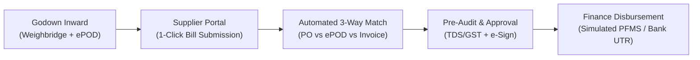

# Automated State Commodity Supplier Billing and Payment Processing

[](https://fastapi.tiangolo.com/)
[](https://supabase.com/)
[](https://python.org)
[](backend/tests/)

> **Seva First Innovation Challenge (SFIC 2026)**  
> **Problem Statement Code**: `PS000007`  
> **Nodal Agency**: Gujarat State Civil Supplies Corporation Limited (GSCSCL)  
> **Department**: Food, Civil Supplies & Consumer Affairs Department, Government of Gujarat  

---

## 1. Overview & Problem

GSCSCL procures and distributes millions of metric tonnes of essential foodgrains across 250+ godowns in Gujarat. The legacy process relies on physical paper slips ("Yellow Receipts") couriered to Gandhinagar Head Office, manual file processing, and multi-channel coordination, resulting in **30–60 day payment delays**.

### Core Solution
- **Digital Delivery Confirmation**: Replaces physical paper slips with cryptographically authenticated electronic Proof of Delivery (**ePOD**) generated at godowns.
- **1-Click Bill Submission**: Suppliers submit invoices against verified ePOD records with auto-populated contract purchase order rates.
- **Automated 3-Way Reconciliation**: Algorithmically cross-matches:
  $$\text{Purchase Order (Contract Terms)} \iff \text{Godown Inward (Weighbridge Gross/Tare/Moisture)} \iff \text{Supplier Invoice}$$
- **Role-Based Workflow Pipeline**: Digital handoff through branch scrutiny, statutory pre-audit (TDS/GST), GM approval, and Finance disbursement.
- **Turnaround Reduction**: Compresses processing cycle from **30–60 days to 3–7 days**.

---

## 2. System Architecture



### Technology Stack
- **Backend API**: Python 3.11+, FastAPI, Uvicorn ASGI
- **Database & Auth**: Supabase PostgreSQL 15+ with 45 Row-Level Security (RLS) policies
- **Security**: Cryptographic Supabase JWT verification (`ES256` via JWKS public keys, `HS256` for local dev)
- **Data Validation**: Pydantic V2 & `pydantic-settings`
- **Testing**: Pytest, Pytest-Asyncio, HTTPX

---

## 3. Database Schema

The database models the complete procurement-to-payment lifecycle across 12 relational tables under Row-Level Security:

| Table | Purpose |
| :--- | :--- |
| `user_profiles` | User accounts and role mapping (`SUPPLIER`, `GODOWN_MANAGER`, `BRANCH_OFFICER`, `PRE_AUDITOR`, `GENERAL_MANAGER`, `FINANCE_OFFICER`, `ADMIN`) |
| `suppliers` | Registered state commodity supplier master records |
| `godowns` | Government storage depots and warehouses across Gujarat |
| `supply_orders` | Procurement purchase orders, contracted rates, and quantities |
| `deliveries` | Physical deliveries recorded at godowns (gross/tare weights) |
| `delivery_receipts` | Tamper-proof digital delivery receipts (ePOD) |
| `bills` | Supplier tax invoices submitted against verified deliveries |
| `bill_deliveries` | Junction mapping invoices to verified delivery line items |
| `workflow_tasks` | Stage-wise routing and processing docket state machine |
| `approvals` | Immutable audit log of review and sign-off decisions |
| `payments` | Payment vouchers, simulated banking state, and UTR tracking |
| `audit_logs` | Centralized immutable audit ledger for statutory compliance |

> See [DATABASE_SETUP.md](DATABASE_SETUP.md) for full SQL migration details and security policy definitions.

---

## 4. Quickstart & Local Setup

### Prerequisites
- Python 3.11+
- Git
- Supabase project credentials

### Setup Steps
```bash
# 1. Clone repository
git clone https://github.com/cdivy3154-gif/automated-supplier-and-billing-processing.git
cd automated-supplier-and-billing-processing

# 2. Configure environment variables
cp backend/.env.example backend/.env
# Edit backend/.env with your Supabase credentials:
# SUPABASE_URL=https://<project-ref>.supabase.co
# SUPABASE_KEY=<anon-key>
# SUPABASE_SERVICE_ROLE_KEY=<service-role-key>
# SUPABASE_JWT_SECRET=<jwt-secret>

# 3. Install dependencies
cd backend
python -m pip install -r requirements.txt

# 4. Run test suite
python -m pytest

# 5. Start development server
uvicorn app.main:app --reload --host 127.0.0.1 --port 8000
```

- **Interactive API Docs (Swagger UI)**: [http://127.0.0.1:8000/docs](http://127.0.0.1:8000/docs)
- **Alternative ReDoc**: [http://127.0.0.1:8000/redoc](http://127.0.0.1:8000/redoc)
- **Service Health Check**: [http://127.0.0.1:8000/api/v1/health/](http://127.0.0.1:8000/api/v1/health/)

---

## 5. API Structure

```
backend/app/api/v1/
├── endpoints/
│   ├── auth.py        # Token validation & current user context (/api/v1/auth/me)
│   ├── health.py      # Liveness, readiness, and DB connection probes (/api/v1/health/)
│   ├── deliveries.py  # Godown inward entry & ePOD generation (Phase 2C)
│   ├── bills.py       # Supplier bill submission & 3-way reconciliation (Phase 2C)
│   └── payments.py    # Payment initiation, deductions & gateway webhooks (Phase 2B)
└── api.py             # Router aggregation
```

---

## 6. Testing

The backend includes automated test coverage across authentication, authorization, and system health:

```bash
# Run all tests
pytest -v

# Run specific test modules
pytest tests/test_auth.py
pytest tests/test_health.py
pytest tests/test_config.py
```

Database-level RLS policies and constraints are verified via SQL test suites located in `sql/` (`security_verification.sql`, `tests.sql`).
